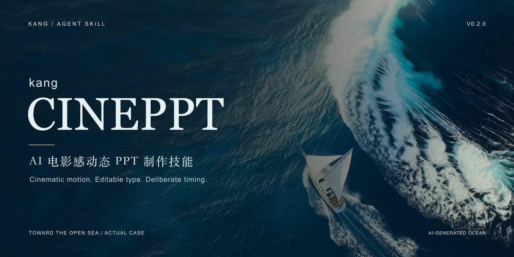
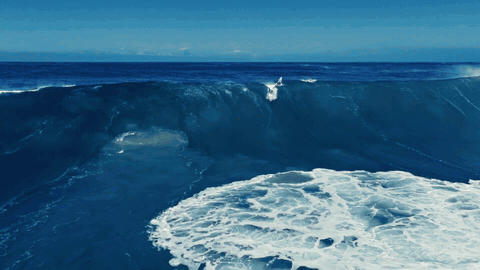

<div align="center">



# kang-cineppt

**把动态画面，做成工作中用得上的 PPT 收尾。**<br>
电影感背景 · 可编辑中文排版 · 原生淡入 · 宣传视频


[](LICENSE)
[](docs/VALIDATION.md)

[中文](README.md) · [English](README.en.md) · [小白教程](docs/QUICK-TUTORIAL.md) · [案例与下载](docs/CASE-LIBRARY.md) · [制作流程](references/workflow.md)

</div>

将全屏视频、原生可编辑文字和克制的淡入组合为两页动态 PPT。可以用于汇报结尾，也可导出宣传 MP4。支持已有素材、免费授权实拍素材，或经费用确认后的 AI 视频生成。

## 先看新作品

| 《乘势而上》：海洋与团队汇报 | 《山河在心》：庄重主题汇报 |
|---|---|
| [](https://github.com/KanG-ciyuan/kang-cineppt/releases/download/v0.2.0/chengshi-er-shang-18s-1080p.mp4) | [](https://github.com/KanG-ciyuan/kang-cineppt/releases/download/v0.2.0/shanhe-zaixin-18s-1080p.mp4) |
| 巨浪与微小冲浪者形成尺度反差，第二页回到深蓝海面的留白。 | 国旗明确主题，长城展开空间，文字在画面建立后依次淡入。 |
| [完整视频 · 18秒](https://github.com/KanG-ciyuan/kang-cineppt/releases/download/v0.2.0/chengshi-er-shang-18s-1080p.mp4) · [可编辑PPTX](https://github.com/KanG-ciyuan/kang-cineppt/releases/download/v0.2.0/chengshi-er-shang-18s.pptx) | [完整视频 · 18秒](https://github.com/KanG-ciyuan/kang-cineppt/releases/download/v0.2.0/shanhe-zaixin-18s-1080p.mp4) · [可编辑PPTX](https://github.com/KanG-ciyuan/kang-cineppt/releases/download/v0.2.0/shanhe-zaixin-18s.pptx) |

上方 GIF 均为**真实最终成片的低帧率节选**，不是完整视频的流畅度示范。完整视频为 1080p、30fps，取自实际 Keynote 导出后裁切、配乐。新案例均使用免费许可实拍素材，没有调用付费视频生成模型。[逐条来源与授权](docs/MEDIA-SOURCES.md)

### 原案例《向海而行》

[](docs/assets/xiang-hai-er-xing.mp4)

AI 海洋背景与原生文字结合的起点案例。[完整预览](docs/assets/xiang-hai-er-xing.mp4) · [两页效果与制作记录](docs/CASE-STUDY.md)

《天地之间》另列为[探索与迭代](docs/cases/tiandi-zhijian.md)：保留雪山、云雾山路与排版经验，也保留“第一版冲击力不足”的反馈，不把探索版列为已获审美认可的成功作品。

**验证边界：** 作品有各自的 Keynote 打开、放映或导出记录；Skill 包仍只完成静态检查。未安装 Skill、未在其他 Agent 环境复现，也未为此次发布运行新的端到端测试。PowerPoint/WPS 的实际放映尚未验证。[完整验证记录](docs/VALIDATION.md)

## 你可以直接这样说

- “先找两段免费授权的横屏实拍素材，让我确认动态和色调后，再做两页汇报收尾 PPT。”
- “巨浪要有尺度反差，整页都在动，文字要能编辑。”
- “做庄重的爱国主题结尾，国旗和长城都可以，先看素材。”
- “视频先播放，文字尽早完整淡入，不要倒放或循环回到起点。”
- “我最后要发 MP4，也要保留 PPTX；付费调用前确认费用。”

## 如何使用

先读 [SKILL.md](SKILL.md)，由你使用的 Agent 按官方机制载入完整目录。下载 [v0.2.0 源码与案例](https://github.com/KanG-ciyuan/kang-cineppt/releases/tag/v0.2.0)。常见 Agent Skills CLI 写法如下，**本项目未执行或验证该安装命令**：

```bash
npx skills add KanG-ciyuan/kang-cineppt
```

需要能够操作文件与演示软件的 Agent，以及已授权的原生 PPT 制作能力。Keynote 只有案例级证据，PowerPoint/WPS 需自行实播。可选辅助工具为 Python 3.10+、FFmpeg/FFprobe；不附专有 SDK、字体、模型或演示软件，不要求安装私有 `@oai/artifact-tool`。

纯视频剪辑、普通静态 PPT 和开发动画系统不属于此 Skill。

## 制作流程

明确汇报用途与文案 → 筛选并核对素材许可 → 动态预览与确认 → 视频修整 → 原生文字排版与嵌入视频 → 目标软件实播 → 按需导出并检查 MP4。

这次补充的经验：

- 免费实拍路线同样需要逐条记录来源、许可和使用区间。
- 文字不能被后续浪花或旗面遮住，选素材要看完整运动过程。
- 延长时长优先使用更长原片，必要时才慢放与插值，不能把补帧称为原生高帧率。
- 多组淡入先列绝对时序，再转换相对延迟，避免累加。
- Keynote 导出中的额外等待、额外末帧都要从真实成片检查。[具体处理](references/native-authoring.md)

## 辅助脚本

```bash
# 只读检查 PPTX 结构，不启动放映
python3 scripts/inspect_pptx.py path/to/deck.pptx

# 离线静态检查，不运行创作与转码
python3 scripts/check_package.py
```

辅助脚本仍只有静态审查证据，实际作品使用的宿主工具和案例代码不构成这些脚本已通过独立复现测试。[媒体配方](references/media-recipes.md) · [验收标准](references/acceptance.md)

## 常见问题

| 现象 | 处理 |
|---|---|
| 素材不错，却像风景宣传片 | 先确定汇报用途和收尾文案，景观为表达服务 |
| 主体回到起点 | 关闭不连续循环，单次播放后切页 |
| 文字出不完，视频先停 | 缩短累计延迟，给完整文字留阅读时间 |
| 编辑态文字全在，视频预览没有淡入 | 从幻灯片页首完整放映，不能只点媒体播放 |
| 导出视频出现长停帧 | 检查追加的翻页等待、视频真实时长及多余末帧 |
| 60fps 仍不自然 | 检查原始运动和插值瑕疵，帧率不是审美与流畅的唯一标准 |
| 换设备版式变化 | 处理字体替换，并在目标软件重新放映 |

## 许可与公开范围

作者代码和说明文档使用 [MIT](LICENSE)。**案例视频、GIF、截图和 PPTX 中的外部素材不随 MIT 授权**，按各自许可处理。新增实拍素材适用 Pexels License，音乐适用 Mixkit Stock Music Free License；原 AI 案例继续保留独立权利说明。[第三方说明](THIRD_PARTY_NOTICES.md)

原始第三方参考视频、独立原素材/音乐、字体文件、密钥、私人路径和专有工具未打包。下载 PPTX 不代表获得素材的独立图库分发权。无供应商或画面主体背书。

此次更新不安装 Skill、不调用生成 API、不创建新测试作品、不改 Agent 配置。[版本记录](docs/RELEASE-NOTES.md) · [公开范围](docs/PUBLICATION-REVIEW.md)
