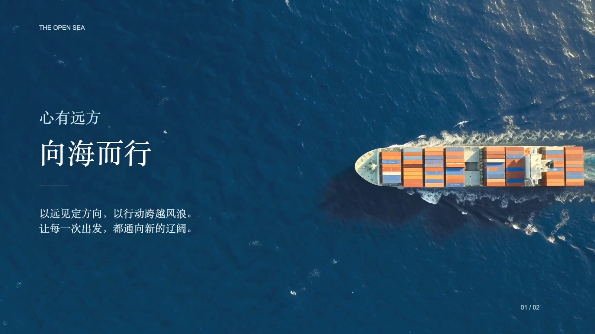
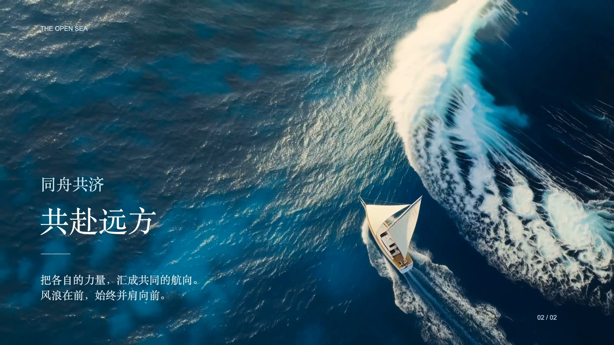

# 向海而行 实际案例

该作品在`kang-cineppt`整理之前已经完成，作者观看后认可效果。此页展示原案例，未为Skill制作新的测试作品。

**AI生成场景**：海洋、货轮、巨浪及帆船背景由AI视频服务生成；文字、线条和时序由原生演示对象完成。预览MP4和GIF仅从原成片转码，场景、文案和次序未重做。

| 页面 | 完整PPT效果 | 出字节奏 |
|---|---|---|
| 心有远方 向海而行 |  | 本页约1.20秒开始，0.90秒淡入，约2.10秒完整 |
| 同舟共济 共赴远方 |  | 本页约0.25秒开始，0.90秒淡入，约1.15秒完整 |

## 已经验证

- 两页16:9的PPTX，背景视频嵌入，中文文字与细线是可编辑原生对象。
- 在Keynote打开最终文件、观察自动播放、组淡入和自动切页，并原生导出影片。
- 原成片H.264、2560×1440、60fps、15.90秒、954帧、静音。背景原片24fps，本地插值到60fps。
- 抽帧和连续性检查未发现既定阈值内的长冻结或黑场；作者实际观看认可。

## 迭代中保留的经验

1. 深蓝不等于暗到没有纹理；货轮页提亮暗部后，海面更完整。
2. 巨浪与小帆船的尺度反差提供纵深，不能只靠平移或高帧率补足。
3. 循环导致货轮回到起点；改为向前播放一次并切页。
4. 分散动画在Keynote中出现延迟累积；改为全部文字和细线一个组一次淡入，第2页提前出字。
5. 最终对外发MP4，PPTX承担可编辑母版职责。

## 没有验证

没有Microsoft PowerPoint或WPS实播放映证据；没有本Skill包的安装、其他Agent复现或新增端到端测试；没有营销转化或传播效果数据。

原始验证摘要与SHA-256见[案例证据](../reports/case-evidence.json)。MIT不覆盖此页链接的演示媒体，见[素材授权](assets/LICENSE.txt)。原始第三方参考视频、参考截图、账单、任务ID与账户信息不随仓库发布。
