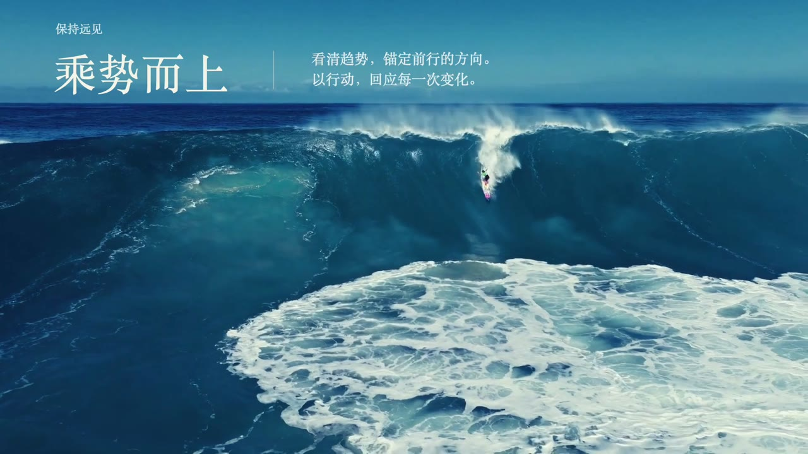
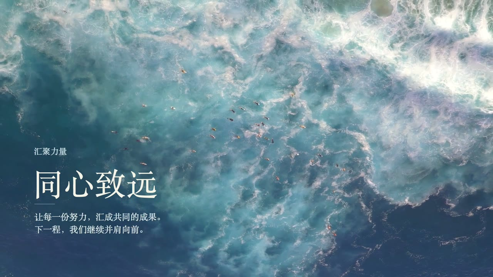

# 《乘势而上》

用途：趋势判断、团队总结或下一阶段展望的两页汇报收尾。作品为免费实拍路线，实际交付采用延长后的 18 秒版。

| 保持远见 / 乘势而上 | 汇聚力量 / 同心致远 |
|---|---|
|  |  |

[完整视频](https://github.com/KanG-ciyuan/kang-cineppt/releases/download/v0.2.0/chengshi-er-shang-18s-1080p.mp4) · [可编辑PPTX](https://github.com/KanG-ciyuan/kang-cineppt/releases/download/v0.2.0/chengshi-er-shang-18s.pptx)

第一幕以巨浪和微小冲浪者建立尺度反差，标题与正文利用天空留白，避开移动浪花。第二幕用俯拍海面承接团队汇报，文字位于深蓝留白。保留确认后的青蓝调色，不额外压暗。

从 12 秒版延长至两页各 9 秒。使用已选素材向前慢放并通过本地运动插值维持 30fps，不把插值称为原生高帧率摄影。文字约 0.45 秒开始整组淡入，持续 0.9 秒，约 1.35 秒全部显示，留出更长阅读时间。

2026-10-25 制作记录包含：最终母版在 Keynote 打开、两页视频自动播放与原生淡入、实际幻灯片影片导出。宣传片取自该原生导出，移除多余末帧后同步配乐。发布整合时重新核对现有文件参数和哈希，没有重新运行创作或端到端测试。PowerPoint/WPS 未实播。

素材：Daniel Torobekov / Pexels 39083377，Jess Loiterton / Pexels 4328577。配乐：Eugenio Mininni / A New Life。出处及许可见[素材记录](../MEDIA-SOURCES.md)。
