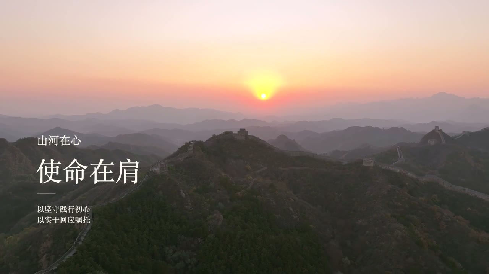

# 《山河在心》

用途：庄重的工作汇报结尾。用国旗明确主题，用长城与山河承接使命，避免做成景点推介。

| 心有所向 / 行有担当 | 山河在心 / 使命在肩 |
|---|---|
|  |  |

[完整视频](https://github.com/KanG-ciyuan/kang-cineppt/releases/download/v0.2.0/shanhe-zaixin-18s-1080p.mp4) · [可编辑PPTX](https://github.com/KanG-ciyuan/kang-cineppt/releases/download/v0.2.0/shanhe-zaixin-18s.pptx)

两页各 9 秒。国旗保留自然色彩，文字位于旗杆左侧；长城只轻微提亮暗部，暖白文字避开霞光与主要城墙走势。未镜像国旗，也没有通过倒放、循环或插帧延长素材。

小标题、主标题、辅助文案与细线分别约在 0.55、0.75、0.95 秒开始，淡入持续 0.9 秒，约 1.9 秒内全部显示。第 9 秒直接切页。

本次遇到两个实际问题：Keynote 将多项“与上一项同时”的延迟继续累加，需按相邻起点差填写；影片导出的翻页等待会附加在视频时长之后，需去掉额外等待，再检查导出结果。修正后再导出，移除每页一个额外末帧，成片为 18.000 秒、540 帧。

2026-10-25 已在 Keynote 打开定稿，实际导出两页原生动画，并检查最终成片文字、切点、全尺寸画面及完整解码。发布整合时只复核现有文件，没有新增端到端测试。PowerPoint/WPS 未实播。

素材：Sanej Prasad Suwal / Pexels 35370477，Eclipse Chasers / Pexels 35834780。配乐：Eugenio Mininni / A New Life。出处及许可见[素材记录](../MEDIA-SOURCES.md)。
