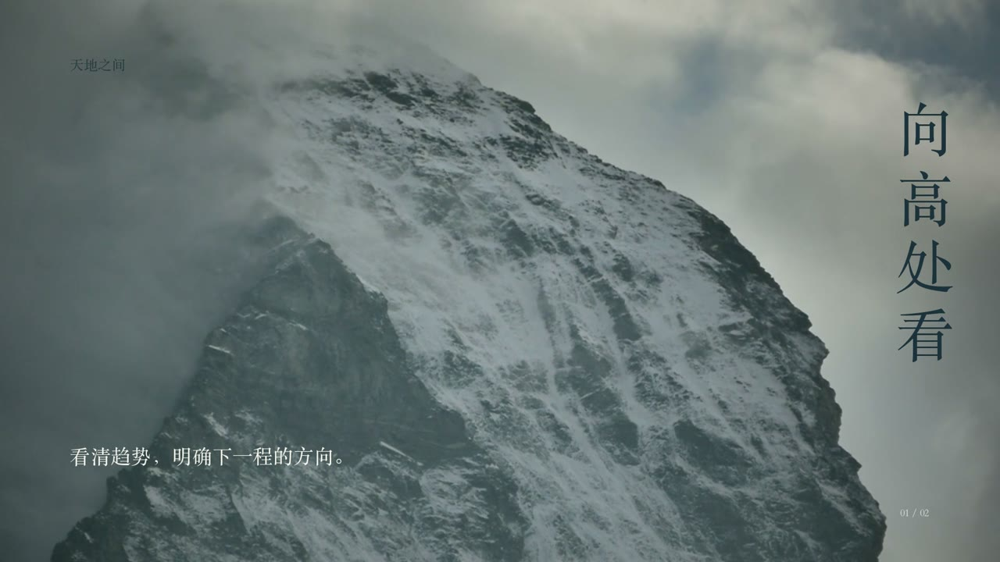
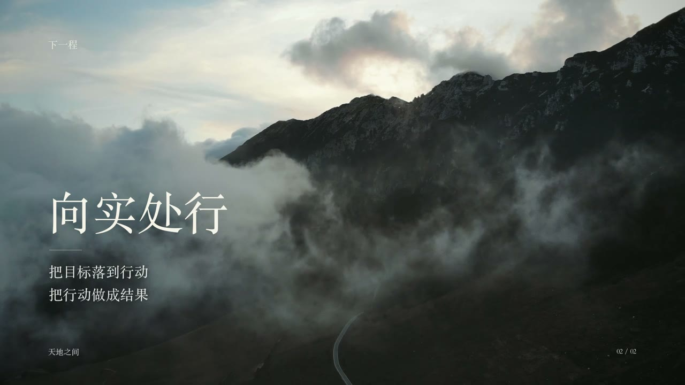

# 《天地之间》：探索与迭代

这是从海洋风格转向山地景观的一次工作汇报收尾探索，保留它是为了说明取舍，不把它列为已获审美认可的主推作品。

| 向高处看 | 向实处行 |
|---|---|
|  |  |

[查看14.4秒探索版](https://github.com/KanG-ciyuan/kang-cineppt/releases/download/v0.2.0/tiandi-zhijian-14.4s-1080p.mp4)

最初以雪峰表达方向，以云雾中的道路表达行动。两页各 7.2 秒，文字约 0.4 秒开始，0.85 秒完成淡入。后续反馈认为第一版的视觉冲击力不及海洋方案，云雾山路的动态可以保留，因此下一轮回到更有尺度反差和色彩冲击的海浪。

可复用的判断：题材新鲜并不等于视觉效果更强；自然景观还要服务工作汇报场景，文字和景观关系比景点数量重要。未经选择的版本应标为探索，避免把所有产物都包装成成功案例。

该版本的 PPTX 有 2026-10-24 Keynote 打开与两页播放记录；宣传 MP4 由 FFmpeg 按相同时序独立合成，**不是 Keynote 放映录像或原生电影导出**。PowerPoint/WPS 未实播。

素材：Cagno Di Media Production / Pexels 2109907，Marian Croitoru / Pexels 5721843。配乐：Eugenio Mininni / A New Life。出处及许可见[素材记录](../MEDIA-SOURCES.md)。
